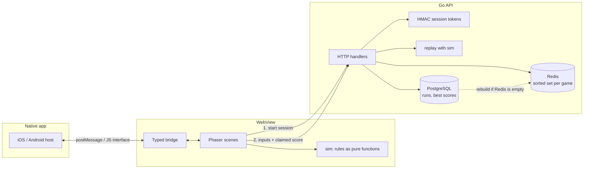

# Pocket Arcade

Two HTML5 mini games built to run inside a mobile app's WebView, with a Go backend that replays every run before a score reaches the leaderboard.

* **Stack**: a block slides back and forth; tap to drop it. Whatever overhangs the tower is cut off, so it narrows until you miss.
* **Dot Rush**: tap each dot before it fades. Dots live a little less long each time, and a round lasts 30 seconds.

The games are TypeScript and Phaser. The backend is Go, with PostgreSQL as the record of every run and a Redis sorted set per game for the leaderboard.



## Why the server replays the game

A score sent by a browser can be anything. Pocket Arcade never trusts it:

1. Before play, the client asks for a **session**. The server signs the game, player, a random seed and the start time into an HMAC token.
2. During play, the client records only the player's **inputs**: for Stack, how many ms after each block appeared the player tapped; for Dot Rush, the time and position of every tap.
3. At the end, the client sends the token, the inputs and the score it computed. The server **replays the inputs** with its own copy of the rules. The run is rejected if:

| Check | Response |
|---|---|
| Token forged or edited | `401 bad_token` |
| Token older than 15 minutes | `410 expired` |
| Inputs faster than a person can tap, out of order, or too many | `422 bad_inputs` |
| Replayed score differs from the claimed score | `422 score_mismatch` |
| The run is longer than the time since the session was issued | `422 too_fast` |
| The session already has a score (Redis `SETNX`, then the runs primary key) | `409 already_submitted` |

Dot Rush positions come from the session seed, so the server knows where every dot was. A tap on a dot that did not exist simply misses.

### One set of rules in two languages

The game draws from `web/src/sim` and the server replays with `server/internal/sim`. All arithmetic is integer (including a `mulberry32` RNG using `Math.imul` on one side and `uint32` on the other), so the two produce identical results. `server/cmd/genvectors` writes seeded runs to [`testdata/vectors.json`](testdata/vectors.json) and **both** test suites replay them, so client and server cannot drift apart without a test failing. CI also checks the committed vectors are current.

## The WebView bridge

[`web/src/bridge/bridge.ts`](web/src/bridge/bridge.ts) gives the games one typed API whatever hosts them:

| Host | Web to native | Native to web |
|---|---|---|
| iOS `WKWebView` | `webkit.messageHandlers.pocketArcade.postMessage(obj)` | `PocketArcade.receive(json)` |
| Android `WebView` | `PocketArcadeAndroid.postMessage(json)` (a `@JavascriptInterface`) | `evaluateJavascript("PocketArcade.receive(...)")` |
| React Native WebView | `ReactNativeWebView.postMessage(json)` | `injectJavaScript` |
| iframe (the harness) | `parent.postMessage` | `postMessage` from the parent only |
| Plain browser | haptics fall back to `navigator.vibrate` | none |

Messages carry a protocol version. Events from the host (`pause`, `resume`, `back`, `safeArea`, `player`) are validated before the game sees them, because an app can be older or newer than the page it loads; unknown events are dropped and inset values are clamped. A host that throws while receiving cannot crash the game.

Things that make it behave like part of the app rather than a web page:

* **Safe areas**: layout uses `--safe-*` CSS variables that default to `env(safe-area-inset-*)`. Some Android WebViews report 0 there even under a notch or gesture bar, so the host can send real insets and they override the CSS.
* **Lifecycle**: a `pause` from the host (call, app switch) or `visibilitychange` pauses the run. Frame deltas are capped at 100 ms so a stalled frame cannot skip game time.
* **Touch**: the stage is `touch-action: none` (no scroll or pinch while playing), buttons use `touch-action: manipulation` (no 300 ms delay), no tap highlight, no long press menu, no rubber band scroll, 48 px targets, `16px` inputs so iOS does not zoom.
* **Sizing**: `100dvh` tracks browser bars, the canvas follows its container through a `ResizeObserver`, Stack fits the board to the width, and Dot Rush letterboxes a fixed 360 x 640 arena so positions mean the same thing on every screen.
* **Load time**: the home screen ships without Phaser. The engine is fetched while the player chooses a game, so the first screen needs about 6 KB of gzipped JavaScript instead of about 345 KB. The game loop sleeps between runs, which also stops Phaser from shrinking a hidden canvas to 0 x 0 and losing its WebGL framebuffer.
* **Offline**: if the session request fails, the game still plays locally and says the run will not be saved.

### Harness

`/harness.html` stands in for the native app: it frames the game at real phone sizes, draws the notch and gesture bar, sends insets the way an Android host would, and logs bridge traffic both ways.

## Leaderboard storage

PostgreSQL holds every run (`runs`, keyed by session id) and each player's best (`best_scores`). A submission inserts the run and raises the best with `GREATEST` in one transaction, locking the player's row so concurrent runs see a consistent previous best.

Redis holds `lb:<game>`, a sorted set of player id to best score, updated with `ZADD GT` so a worse run can never lower a best. Top N is `ZREVRANGE` and a player's rank is `ZREVRANK`, both O(log n).

Redis is a cache, not the record:

* If the sorted set is missing (Redis restarted or flushed), the next read rebuilds it from `best_scores`.
* If Redis is down, reads fall back to PostgreSQL (`"source": "database"` in the response) and submissions still save; the runs primary key stops a session being used twice.

## API

| Method | Path | |
|---|---|---|
| `POST` | `/v1/sessions` | `{game, playerId, name}` to `{sessionId, token, seed, issuedAt, expiresInMs}` |
| `POST` | `/v1/scores` | `{token, claimedScore, taps}` to `{score, best, personalBest, rank}` |
| `GET` | `/v1/leaderboards/{game}?limit=10&player=id` | top N, plus your rank if you are outside it |
| `GET` | `/healthz` | database and cache status |

## Run it

```bash
# everything in containers: http://localhost:8080 and /harness.html
docker compose up --build

# or for development, no database needed
make dev-server   # Go API on :8080, scores kept in memory
make dev-web      # Vite on :5173, reachable from a phone on the same Wi-Fi
```

## Tests

```bash
make test
```

* **Go (24 tests)**: simulation rules and the shared vectors, token signing, tampering and expiry, and end to end HTTP tests of the submission flow: a full run reaching the leaderboard, replayed sessions, mismatched scores, too fast runs, forged and expired tokens, bests that only go up, ranking across players, rebuilding Redis from PostgreSQL, and serving from PostgreSQL when Redis fails. The end to end tests run against the in memory store and, when `TEST_DATABASE_URL` and `TEST_REDIS_URL` are set (as in CI), against real PostgreSQL and Redis as well.
* **Web (36 tests)**: the TypeScript simulation against the same vectors, bridge transport detection, message validation, iframe origin checks, lifecycle pausing, safe area variables, and the API client's retry rules (it retries a submission through a brief outage, which is safe because each session is accepted once, but never retries a rejection).

Benchmarks on a 2 vCPU VM: replaying a 60 block Stack run takes about 0.24 µs and a full Dot Rush round about 0.55 µs; a whole submission over HTTP against PostgreSQL and Redis takes about 2 ms.

## Layout

```
server/
  cmd/server        HTTP server, configured by environment variables
  cmd/genvectors    writes testdata/vectors.json
  internal/api      handlers and end to end tests
  internal/session  HMAC session tokens
  internal/sim      game rules for replay
  internal/store    PostgreSQL, Redis and in memory stores
web/
  src/bridge        WebView bridge and safe areas
  src/sim           game rules, the twin of server/internal/sim
  src/games         Phaser scenes (drawing and input only)
  src/api           API client
  harness.html      simulated native host
testdata/vectors.json
```

## Limits

Replay proves a run follows the rules, not that a person played it: a bot that taps perfectly will post a perfect score. The minimum gaps between taps raise the bar, and the next step would be per player rate limits and flagging statistically unlikely runs for review.
